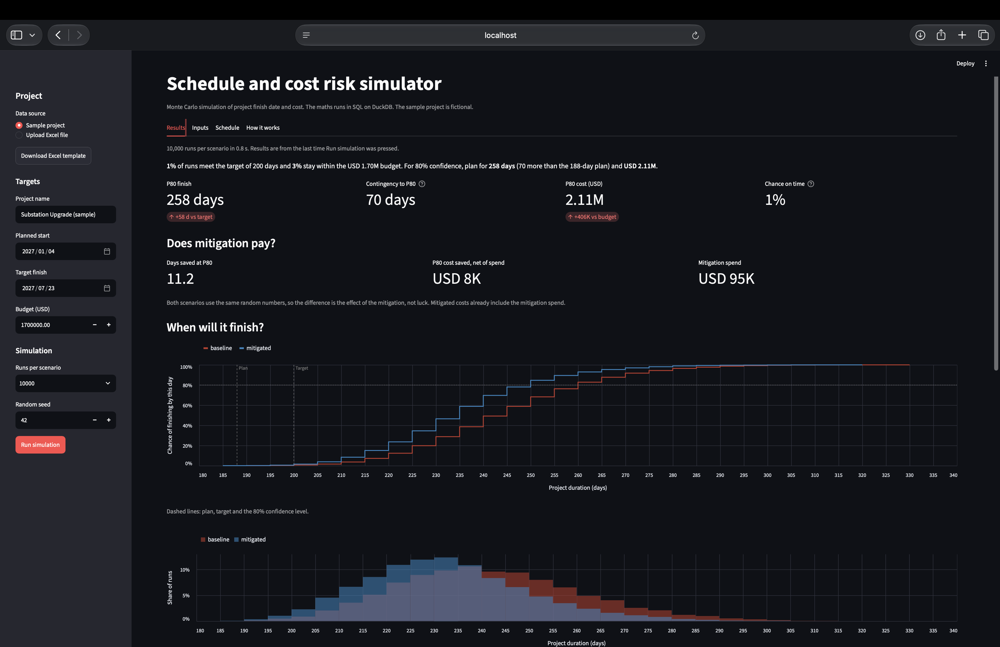
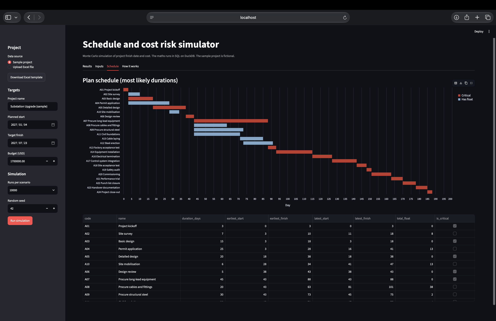
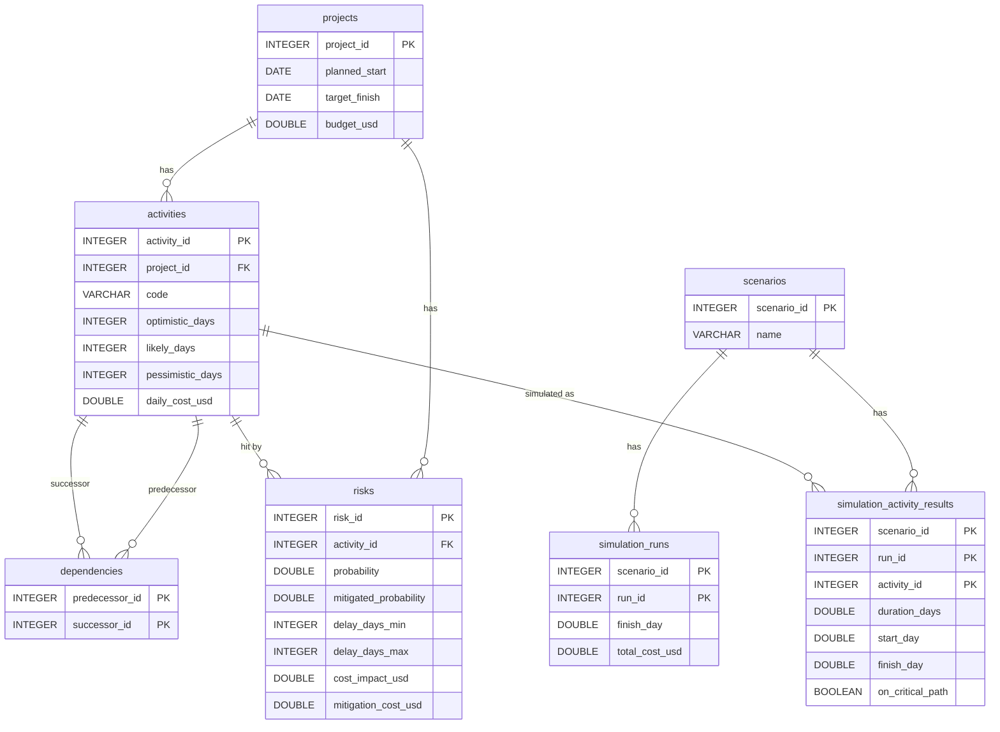

# Schedule and Cost Risk Simulator

A Monte Carlo simulator that turns a project's task list and risk register into a forecast: the chance of hitting a finish date and a budget, the contingency needed for 80% confidence, and the risks and activities that drive the outcome.

**The analysis is written in SQL (DuckDB).** Python only loads the data, swaps in the run count and seed, and draws the charts.

**Live app:** https://schedule-cost-risk-simulator.streamlit.app *(replace with the deployed link)*



All data is synthetic. The sample project is a fictional substation upgrade, and nothing in this repository comes from an employer or client.

## What it answers

For the sample project (24 activities, 8 risks, 10,000 runs per scenario, seed 42):

| | Plan | Simulated |
|---|---|---|
| Finish | 188 days (most likely durations, no risk events) | P80 is 258 days, 70 more than the plan |
| Meets the 200-day target | n/a | 1% of runs |
| Cost | USD 1.56M | P80 is USD 2.11M against a USD 1.70M budget; 3% of runs stay within budget |
| Mitigation (USD 95K spend) | n/a | Saves 11.2 days at P80 and about USD 8K net on P80 cost |

What the sample shows:

- **A plan built on most likely durations is optimistic.** Skewed estimates and risk events push the finish date well past the plan, so the contingency is large.
- **The risk that moves the date is not the risk that costs most.** Late long-lead equipment adds the most days when it happens. Adverse ground conditions is the largest cost risk. The cable price risk is a budget problem and barely moves the date.
- **Criticality changes once uncertainty is added.** In the plan, procurement of long-lead equipment is on the critical path. In the simulation, steel erection and civil foundations also become critical in a large share of runs, because they have little float.
- **Mitigation roughly pays for itself.** It does not save a lot of money at P80, but it buys about 11 days for little net cost.

The results are an illustration of the method on invented numbers, not a forecast of any real project.

## How it works

Each activity has a three-point estimate (optimistic, most likely, pessimistic). Each risk has a probability, a delay range, a cost and a mitigated probability. Every run draws a duration for each activity, decides which risks happen, finds that run's critical path and totals the cost. Two scenarios are simulated: **baseline** (risks as assessed) and **mitigated** (lower probabilities, plus the mitigation cost).

The SQL files run in order:

| File | What it does | SQL used |
|---|---|---|
| `01_schema.sql` | Tables with keys and constraints | Primary and foreign keys, `CHECK` constraints |
| `02_seed.sql` | Loads the sample project | `INSERT` |
| `03_critical_path.sql` | Critical path, float and the critical flag | Recursive CTE, window functions |
| `04_simulate.sql` | 10,000 runs per scenario with random durations and risk events | `generate_series`, cross joins, seeded `random()`, window functions |
| `05_results.sql` | Percentiles, contingency, criticality index, risk impact, comparison | Views, `quantile_cont`, `FILTER`, window functions over aggregates |



### Design decisions

- **Path enumeration instead of the textbook forward pass.** Earliest start is normally the maximum of the predecessors' finish dates, but a recursive CTE cannot use `MAX()` in its recursive part. So the recursive CTE lists every start-to-finish path once (24 paths in the sample), and window functions add up durations along each path. Grouping by activity then gives earliest and latest dates and float. The same path table is reused in every simulation run.
- **Random numbers are stored, then everything else is deterministic.** All random draws go into two tables first (`sim_u_activity`, `sim_u_risk`). Later steps are plain functions of those tables, so any run can be audited and a seed makes the whole file reproducible.
- **Triangular durations by inverse CDF.** Only `random()` is needed, with no extension or Python.
- **Common random numbers across scenarios.** Both scenarios use the same draws. A risk happens when its draw is below its probability, so every risk that happens in the mitigated scenario also happens in the baseline. The gap between scenarios is then the effect of mitigation, not luck. A consequence: in any single run, the mitigated finish can never be later than the baseline finish, which the check scripts test.
- **Risk impact as a difference of means.** For each risk, the average finish date in runs where it happens minus the average in runs where it does not. This is fair because each risk is drawn independently.

### Definitions

- **P50 / P80:** the finish date (or cost) that 50% / 80% of runs come in at or below.
- **Contingency to P80:** P80 minus the plan, the buffer needed for 80% confidence.
- **Total float:** how many days an activity can slip without delaying the project.
- **Criticality index:** the share of runs in which an activity is on the critical path.

## Data model



The app also reads these views: `activity_schedule`, `scenario_summary`, `contingency_p80`, `activity_sensitivity`, `risk_impact`, `finish_distribution` and `scenario_comparison`.

## Using your own project

Download the Excel template from the app's sidebar (it contains the sample project), edit the three sheets (`activities`, `dependencies`, `risks`) and upload it. The app checks the file before running: dependency loops, unknown activity codes, estimates out of order, probabilities outside 0 to 1, and networks too large to simulate. The risks table can also be edited directly in the app.

## Run it locally

```bash
python -m venv .venv
source .venv/bin/activate
pip install -r requirements.txt

python check_setup.py            # schema and sample data
python check_critical_path.py    # critical path
python check_simulation.py       # simulation
python check_results.py          # result views

python -m streamlit run app.py
```

The check scripts write a `risk_simulator.duckdb` file in the current folder. The app does not use it: it builds a fresh in-memory database each time you press Run.

### How the results were checked

The expected values in the check scripts were worked out separately in plain Python: the critical path by hand, and the simulation percentiles with an independent implementation of the same model. The scripts also test rules that must hold in every run, for example that the first and last activities are always critical, no duration falls below its optimistic estimate, and the mitigated scenario never finishes later than the baseline in the same run. Percentile checks allow a small tolerance for random variation.

## DuckDB for PostgreSQL users

DuckDB runs inside the Python process with no server, which is why the app deploys with nothing else to set up. Its SQL is close to PostgreSQL. These are the differences I know of in this project. I have not run these files on PostgreSQL.

| DuckDB (used here) | PostgreSQL equivalent |
|---|---|
| `quantile_cont(x, 0.8)` | `percentile_cont(0.8) WITHIN GROUP (ORDER BY x)` |
| List literal `[a]`, `list_append`, `list_position`, `unnest(list)` | `ARRAY[a]`, `array_append`, `array_position`, `unnest(array)` |
| `DOUBLE` | `DOUBLE PRECISION` |
| `any_value(x)` | `any_value` (version 16 and later) or `min(x)` |
| `SET threads = 1` so `setseed()` repeats | Not needed |
| `generate_series(1, n) AS r(run_id)`, `FILTER`, `WITH RECURSIVE`, window frames | Same |

## Limitations

- **Invented data.** The sample project and its numbers are illustrative.
- **Calendar days only.** No working calendars, holidays or weekends.
- **Finish-to-start links only.** No lags, overlaps or resource constraints.
- **Independent estimates.** Activity durations and risks are drawn independently. Real projects have correlated delays, which would widen the range of outcomes.
- **Triangular distribution.** A common choice for three-point estimates, but it is an assumption.
- **One activity per risk, fixed cost.** A risk delays one activity by a uniform amount and adds a fixed cost.
- **Mitigation works as stated.** The mitigated probabilities are inputs, not results.
- **One project at a time.** The results tables carry no project id.
- **Size limits.** At most 200 activities and 5,000 start-to-finish paths, because every run is evaluated over every path. Runs are lowered automatically for very large networks.
- **Random variation.** Percentiles move slightly between seeds, so quote them as approximate.

## Repository layout

```
app.py                  Streamlit interface
simulator.py            Input checks and the SQL pipeline
sql/                    The analysis: 01_schema to 05_results
check_*.py              Scripts that run each SQL file and check the output
docs/                   Screenshots
requirements.txt
```

## Licence

MIT. See `LICENSE`.
